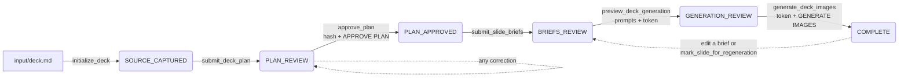

# Decksmith

Turn a Markdown brief into a reviewed slide plan, then into consistent, on-brand slide visuals — with a human approval gate before anything costs money.

Built as an [MCP](https://modelcontextprotocol.io) server for [Claude Code](https://claude.com/claude-code). Claude does the planning and writes the visual briefs; the server enforces the workflow, tracks state on disk, and refuses to spend on images until you have seen exactly what will be generated. Visual identity is pluggable: pick from three shipped visual systems or add your own in one Markdown file.

## Why this exists

Generating slide images with an AI model is easy. Generating a *deck's worth* of images that share one visual language, say only what the source material supports, and don't burn API credits on unreviewed prompts is not. This project encodes the discipline:

- **Plan first.** The model proposes a full slide plan from your source and stops. You review it as a table, correct it, and approve a specific content hash.
- **Brief every image.** Each visual gets a structured brief: one approved layout pattern, 3–7 elements, the exact strings allowed inside the image, and what to avoid.
- **See the bill before paying.** A preview step writes every final prompt to disk and returns the exact number of paid calls plus a one-time approval token.
- **Regenerate surgically.** Change one brief, and only that slide is pending. Everything else keeps its image. Previous versions are archived, never overwritten.
- **Stay on-brand.** Every prompt embeds a visual system — colour tokens, form language, typography, anti-style, and a quality gate. Swap the system, and the same brief renders in a different identity.

## One brief, three visual systems

The same brief — [`examples/demo-deck/briefs/quality-gate-before-after.json`](examples/demo-deck/briefs/quality-gate-before-after.json), a `before_after` pattern from the demo deck — rendered under each shipped system. Nothing changed between runs except the visual system name passed to the CLI. The exact in-image text (`Today`, `Manual review`, `Quality gate`, `Automated checks`, `Humans maintain the rules`) is fixed by the brief; the identity comes from the system.

| `corporate-blue` | `minimal-mono` | `warm-editorial` |
|---|---|---|
|  |  |  |

Each PNG sits next to a `.json` with the full prompt, model, and settings that produced it. The images are shown unedited, including their flaws — the workflow's review step exists precisely because a model does not always honour every constraint on the first attempt.

```bash
uv run decksmith visual examples/demo-deck/briefs/quality-gate-before-after.json \
  --visual-system minimal-mono --output-dir examples/demo-deck/images/minimal-mono \
  --generate --confirm "GENERATE IMAGE"
```

## How it works



Every transition is persisted to `output/<deck>/manifest.json`. Any change to the plan, a brief, or the visual system invalidates prior approval and forces a fresh review. Chat memory is never the source of truth; the manifest is.

| Stage | What you can inspect | Paid calls |
|---|---|---:|
| `SOURCE_CAPTURED` | Copied source, manifest with chosen visual system | 0 |
| `PLAN_REVIEW` | `slide-plan.json` and a plan table in chat | 0 |
| `PLAN_APPROVED` | Approved plan hash | 0 |
| `BRIEFS_REVIEW` | One JSON brief per visual | 0 |
| `GENERATION_REVIEW` | Final prompts on disk, pending count, approval token | 0 |
| `GENERATING` | Partial progress, resumable on failure | Yes |
| `COMPLETE` | PNGs and per-image reproducibility metadata | Done |

## Quickstart

Requirements: Python 3.11+, [`uv`](https://docs.astral.sh/uv/), Claude Code, and an OpenAI API key with image access.

```bash
git clone <this-repo> && cd decksmith
uv sync
cp .env.example .env    # then set OPENAI_API_KEY
uv run decksmith setup  # pick a default visual system and image settings
claude                  # Claude Code picks up .mcp.json automatically
```

Write your source material to `input/<deck-name>.md` (see `templates/INPUT_TEMPLATE.md` or `examples/demo-deck/source.md`), then tell Claude:

> Process `input/<deck-name>.md` as a new presentation. Follow CLAUDE.md and stop to show me the complete slide plan before creating briefs or images.

Claude will ask which visual system to use if you did not name one, show you the plan, and wait. After corrections:

> Approved, hash `<the hash it showed>`.

It writes the briefs, previews the prompts, and reports how many paid calls the batch will make. Then:

> Authorize the batch.

Images land in `output/<deck-name>/images/`. Titles stay out of the images by design; you place them in your slide tool.

## Visual systems

A visual system is one Markdown file at `visual-systems/<name>/system.md` describing colour tokens and their semantics, form language, composition rules, typography, an anti-style list, and a quality gate. It is embedded verbatim in every prompt for that deck.

| Name | Character | Good for |
|---|---|---|
| `corporate-blue` | Flat-vector consulting-deck infographics, navy outlines, orange for change, green only for validation | Executive and stakeholder decks (default) |
| `minimal-mono` | Near-monochrome monoline diagrams, one violet accent used on at most two elements | Engineering reviews, technical audiences |
| `warm-editorial` | Cream paper, terracotta and olive, softly rounded hand-drawn-then-cleaned shapes | Narrative, people, and product-story decks |

Pick one per deck (`initialize_deck(..., visual_system="minimal-mono")`) or set the default in `decksmith.toml`. The chosen system is recorded in the deck's manifest and folded into the approval token, so switching it mid-deck correctly requires re-review.

**Add your own:** create `visual-systems/<your-name>/system.md`. Start from `corporate-blue/system.md` and keep the same section headings — the first `#` heading becomes its title and the first paragraph its summary in `list_visual_systems`. Run `uv run decksmith systems` to confirm it is picked up. No code changes needed.

**Keep one private:** name the folder `visual-systems/local-<name>/`. It works exactly like the others but is git-ignored, so an employer's brand guidelines can live next to the public systems without ever being committed.

Layout patterns (`transformation`, `pipeline`, `before_after`, …) are shared across systems and live in `templates/VISUAL_PATTERNS.md`; a brief uses exactly one.

## Configuration

`decksmith.toml` at the project root:

```toml
[project]
default_visual_system = "corporate-blue"
input_dir = "input"
output_dir = "output"
visual_systems_dir = "visual-systems"
patterns_file = "templates/VISUAL_PATTERNS.md"

[image]
model = "gpt-image-2"
quality = "high"
size = "1536x1024"
```

`OPENAI_IMAGE_MODEL`, `OPENAI_IMAGE_QUALITY`, and `OPENAI_IMAGE_SIZE` override the `[image]` section. The API key is read only from `OPENAI_API_KEY` and never written anywhere by this project. `uv run decksmith setup` regenerates the file interactively; `uv run decksmith config` prints the resolved values.

## Regenerating one slide

Two paths, neither of which touches the other slides or requires editing state by hand:

- **The brief needs to change** — resubmit the full batch with `submit_slide_briefs`. Briefs whose content is unchanged keep their image; changed ones become pending. Works from `COMPLETE`.
- **Same brief, another attempt** — `mark_slide_for_regeneration(deck, slide)`.

Either way, `preview_deck_generation` then reports `pending_count` (say, `1` of `8`) and a fresh token. On generation the previous PNG is archived as `<slide>.v1.png`, `<slide>.v2.png`, … alongside its metadata.

## MCP tools

| Tool | Purpose | Paid |
|---|---|---|
| `list_visual_systems` | Available systems with title, summary, and which is default | No |
| `initialize_deck` | Create `output/<deck>/` from `input/<deck>.md`, optionally choosing a visual system | No |
| `submit_deck_plan` | Validate and persist a plan; returns its hash | No |
| `approve_plan` | Approve exactly that hash; needs confirmation `APPROVE PLAN` | No |
| `submit_slide_briefs` | Save the full brief batch; reports kept vs pending slides | No |
| `mark_slide_for_regeneration` | Queue a generated slide for another attempt | No |
| `preview_deck_generation` | Write final prompts; return pending count and approval token | No |
| `generate_deck_images` | Generate pending slides only; needs token + `GENERATE IMAGES` | **Yes** |
| `get_deck_status` | Full manifest plus pending list — use it whenever state is unclear | No |
| `preview_slide_prompt` | Render one brief's prompt under any system, outside a deck | No |

`CLAUDE.md` instructs Claude Code how and when to call these, including where it must stop and wait for you.

## CLI

The CLI is for setup and diagnostics; the guided workflow runs through MCP.

```bash
uv run decksmith setup                       # interactive config
uv run decksmith systems                     # list visual systems
uv run decksmith config                      # resolved settings
uv run decksmith init input/deck.md --visual-system warm-editorial
uv run decksmith status deck                 # manifest + pending slides
uv run decksmith visual examples/parallel-sessions-brief.json --dry-run --visual-system minimal-mono
```

## Project layout

```text
decksmith.toml      project configuration
CLAUDE.md                     workflow contract for Claude Code
.mcp.json                     registers the MCP server with Claude Code
visual-systems/<name>/system.md
templates/
  VISUAL_PATTERNS.md          the seven approved layout patterns
  INPUT_TEMPLATE.md           suggested structure for a source file
  slide-brief.schema.json
examples/
  demo-deck/source.md         a fictional, complete input to try the flow on
  parallel-sessions-brief.json  standalone parallel_1n1 brief for preview_slide_prompt / the CLI
input/                        your source decks (git-ignored)
output/<deck>/                per-deck workspace (git-ignored)
  source.md  manifest.json  slide-plan.json  briefs/  prompts/  images/
src/decksmith/
  config.py                   root discovery, TOML, visual-system resolution
  models.py                   Pydantic models: DeckPlan, SlideBrief, Element
  core.py                     prompt composition and the one paid call
  pipeline.py                 the state machine
  mcp_server.py               tool surface
  cli.py
tests/                        offline tests for the state machine, hashing, config, prompts
```

## Development

```bash
uv sync --group dev
uv run pytest
```

Tests run without network access — the image call is stubbed. They cover the approval gates, token invalidation on tampering, partial-failure recovery, the keep-unchanged-images logic, and reading manifests written by earlier versions.

## When not to use this

Be honest about the ceremony. Seven stages and two confirmation strings are tuned for decks that go in front of people who will question every number. They are overkill when:

- **You need one image, not a deck.** Use `preview_slide_prompt` or the `visual` CLI command directly and skip the state machine.
- **The deck is three slides for your own team.** The plan-approval step buys you little; consider letting Claude present plan and briefs in one pass and approving once.
- **Cost is your only concern.** At current image prices the "cost gate" guards cents. Its real value is forcing you to read the exact in-image text before rendering — if you would not read it anyway, the gate is friction.
- **You want finished slides.** This produces images and metadata. Layout, titles, and assembly stay in your presentation tool by design.

Where it pays for itself: a deck of 6–12 visuals that must share one visual language, whose content you will be asked to defend, and which you expect to revise once or twice after feedback.

## Design notes

- **Hashes, not trust.** The plan hash covers `slide-plan.json` byte for byte. The generation token covers the deck slug, plan hash, visual system name, and every final prompt. Editing anything on disk after preview yields a stale token.
- **No invented facts.** The workflow contract forbids Claude from adding metrics, claims, or logos not present in the source, and requires uncertainty to be recorded under `assumptions` / `open_questions` in the plan.
- **Minimal in-image text.** Slide titles are never rendered into images. If a label can live in the slide tool, the brief leaves it out.
- **Nothing assembled.** The output is images plus metadata. Deck assembly stays in your presentation tool where you control layout.

## License

MIT — see [LICENSE](LICENSE).
