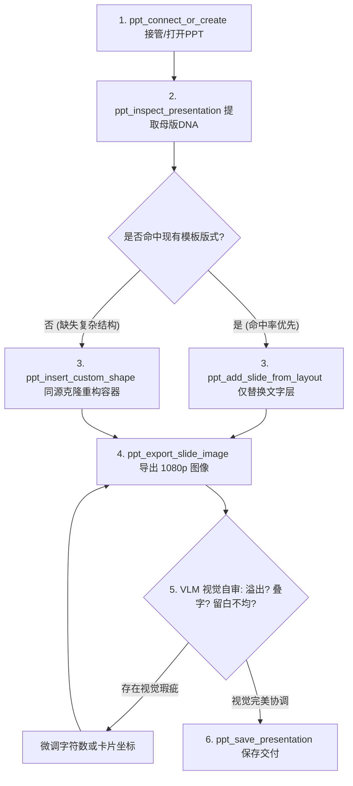

# PowerPoint Native MCP Server

<div align="center">

[](LICENSE)
[](https://www.python.org/)
[](https://www.microsoft.com/windows)
[](https://opencode.ai)
[](https://modelcontextprotocol.io/)

**面向 OpenCode、Claude Desktop、Cursor、Antigravity 等 AI Agent 的 Windows 11 原生 PowerPoint MCP 服务端**

[English Documentation](README_EN.md) | [中文说明文档](README.md)

</div>

---

## 🌟 核心定位与设计理念

`powerpoint-mcp` 是专为大语言模型（LLM）与多模态智能体（VLM Agent）打造的原生 Windows 演示文稿自动化架构。基于 Python **FastMCP / MCPServer** 与 **Windows 原生 COM 接口（pywin32）** 构建。

核心原则：**最大限度保持原生母版血统的纯正性，仅在版式缺失时按其美学规律完成克隆重构。**

- 🖥️ **无缝进程接管**：直接挂载本地已打开的 PowerPoint 窗口，无需频繁重启进程或另存临时文件；
- 🔍 **母版逆向解析**：深度扫描可用版式（`CustomLayouts`）、占位符类型与尺寸坐标，提取调色盘与字体层级（Design DNA）；
- 🛡️ **文本安全注入**：智能命中原生占位符，仅更新文字层（`TextRange`），彻底杜绝硬编码重叠与版面崩塌；
- 🎨 **同源视觉重构**：动态绘制卡片、指标徽章、连接箭头、四象限与流程图，支持 `pt`、`cm`、`px` 等多种度量单位；
- 👁️ **多模态自检闭环**：通过 COM 原生调用 `Slide.Export()` 导出 1920x1080 视网膜高清无损 PNG，供视觉大模型在线走查与自审微调。

---

## 📋 运行环境要求

- **操作系统**：Windows 10 或 Windows 11（x64 / ARM64）
- **Office 软件**：本地已安装 **Microsoft PowerPoint**（Office 2016 / 2019 / 2021 / Office 365 均可）
- **Python 环境**：Python 3.10 或更高版本
- **Agent 客户端**：[OpenCode](https://opencode.ai)、Claude Desktop、Cursor、Windsurf、Antigravity 或任何支持标准 MCP 协议的客户端

---

## 🚀 安装指南（Installation）

### 方式一：通过 Git / pip 一键全局安装（推荐，专为 OpenCode 优化）

在任意 PowerShell 或 CMD 终端执行：

```powershell
pip install git+https://github.com/kangkang0218/powerpoint-mcp.git
```

安装完成后，系统将自动注册全局控制台命令：
- `powerpoint-mcp`（MCP 服务端主入口）
- `ppt-mcp`（简写别名）
- `ppt-mcp-cli`（命令行独立调试工具）

验证安装：
```powershell
powerpoint-mcp --help
```

---

### 方式二：本地源码克隆与开发者模式安装

如果您希望二次开发或本地调试：

```powershell
# 1. 克隆本仓库
git clone https://github.com/kangkang0218/powerpoint-mcp.git
cd powerpoint-mcp

# 2. 以可编辑模式安装（开发者模式）
pip install -e .
```

---

### 方式三：使用 uv / uvx（免安装零污染运行）

如果您的系统安装了 `uv`，无需提前执行 `pip install`，可在调用时直接即时拉取：

```powershell
uvx --from git+https://github.com/kangkang0218/powerpoint-mcp.git powerpoint-mcp
```

---

## 🤖 OpenCode 接入与调用教程

OpenCode（[opencode.ai](https://opencode.ai)）已深度支持 Model Context Protocol。您可以选择以下任意一种方式完成接入：

### 选项 A：使用 OpenCode 命令行一键添加（极简）

在终端中直接运行：

```powershell
opencode mcp add powerpoint -- powerpoint-mcp
```

> **注意**：如果未执行全局 pip 安装，也可以指定 python 模块路径：
> ```powershell
> opencode mcp add powerpoint -- python -m ppt_mcp_server
> ```

---

### 选项 B：修改全局配置文件 `opencode.json`（最稳健）

打开 OpenCode 的全局配置文件：
- 路径：`%USERPROFILE%\.config\opencode\opencode.json`（即 `C:\Users\<你的用户名>\.config\opencode\opencode.json`）

在 `mcp` 节点下添加 `powerpoint` 服务定义：

```json
{
  "$schema": "https://opencode.ai/config.json",
  "mcp": {
    "powerpoint": {
      "type": "local",
      "command": ["powerpoint-mcp"],
      "enabled": true,
      "timeout": 30000
    }
  }
}
```

> **参数说明**：
> - `type`: 固定为 `"local"`（本地 stdio 进程模式）。
> - `command`: 启动命令数组。全局安装后填 `["powerpoint-mcp"]` 即可。
> - `enabled`: 设置为 `true`，随 OpenCode 启动自动加载。
> - `timeout`: 建议设为 `30000`（30秒），防止在首次启动 PowerPoint 或导出高清图时触发超时。

---

### 验证 OpenCode 连接状态

在终端中执行：

```powershell
opencode mcp list
```

如果配置成功，控制台将显示绿色连接成功状态：

```text
T  MCP Servers
|
•  ✓ powerpoint connected
|      powerpoint-mcp
|
—  1 server(s)
```

现在启动 `opencode`，您即可在对话中向 AI 下达自然语言指令，例如：
> “请连接我当前打开的开题报告 PPT，读取所有母版版式，并将第 3 页文献综述提炼为三个理论维度的对比卡片，最后导出高清图进行排版自查。”

---

## 🛠️ 其他主流 AI 客户端接入配置

### 1. Claude Desktop
编辑 `%APPDATA%\Claude\claude_desktop_config.json`：
```json
{
  "mcpServers": {
    "powerpoint": {
      "command": "powerpoint-mcp"
    }
  }
}
```

### 2. Cursor / Windsurf
在项目根目录 `.cursor/mcp.json` 中配置：
```json
{
  "mcpServers": {
    "powerpoint": {
      "command": "powerpoint-mcp"
    }
  }
}
```

---

## 🧰 MCP 核心工具集（Tools Reference）

| 工具名称 | 参数签名 | 功能说明 |
| :--- | :--- | :--- |
| **`ppt_connect_or_create`** | `file_path: Optional[str] = None` | 挂载当前正在运行的 PowerPoint 实例，或启动新进程；打开指定路径 `.pptx` 或连接当前激活文稿。 |
| **`ppt_inspect_presentation`** | *无* | 全景提取文稿元数据：幻灯片总数、长宽尺寸（pt/cm/px）、宽高比（如 16:9）、所有可用母版版式（名称、索引）及占位符层级结构。 |
| **`ppt_add_slide_from_layout`** | `layout_index: int`<br>`title: str`<br>`content_blocks: List[str]` | 根据指定版式索引创建新页面，智能命中标题与正文占位符并注入内容，防止重叠。 |
| **`ppt_insert_custom_shape`** | `slide_index: int`<br>`shape_type: str`<br>`left: float`<br>`top: float`<br>`width: float`<br>`height: float`<br>`text: str = ""` ... | 在指定页面绘制高阶修饰容器（圆角矩形、卡片、流程箭头、菱形等），支持 CSS Hex 颜色、文字自动换行与内外边距。 |
| **`ppt_export_slide_image`** | `slide_index: int`<br>`output_path: str`<br>`width: int = 1920`<br>`height: int = 1080` | 调用 COM 底层 `Slide.Export()` 生成 1920x1080 视网膜级 PNG 渲染图，供多模态大模型进行视觉自审。 |
| **`ppt_save_presentation`** | `output_path: Optional[str] = None` | 原路径静默保存，或另存为新文件（自带弹窗抑制与防冲突保护）。 |
| **`ppt_delete_slide`** | `slide_index: int` | 删除指定幻灯片（用于视觉自检未达预期时的回滚清理）。 |

---

## 🔄 多模态闭环工作流最佳实践（Agent Visual Closed-Loop）



---

## ⚙️ 环境变量配置（可选）

创建 `.env` 文件可定制系统默认行为：

```ini
# 默认渲染导出分辨率
PPT_EXPORT_DEFAULT_WIDTH=1920
PPT_EXPORT_DEFAULT_HEIGHT=1080

# Windows COM RPC 防冲突重试配置
PPT_COM_MAX_RETRIES=5
PPT_COM_RETRY_DELAY_SEC=0.5
PPT_COM_BACKOFF_FACTOR=1.5

# 默认字体
PPT_DEFAULT_FONT_TITLE=Microsoft YaHei
PPT_DEFAULT_FONT_BODY=Microsoft YaHei

# 日志输出等级
PPT_LOG_LEVEL=INFO
```

---

## 常见问题与排错（FAQ）

### Q1: OpenCode 显示 `MCP error -32000: Connection closed`？
- **原因**：通常是因为 `powerpoint-mcp` 没有被安装在全局 Python 路径下，或标准输出被非 JSON-RPC 文本污染。
- **解决办法**：
  1. 运行 `pip install -e .` 或 `pip install git+https://...`。
  2. 在终端直接输入 `powerpoint-mcp`，检查是否有 Python 报错。
  3. 本项目所有运行日志严格通过 `sys.stderr` 输出，绝不污染 `sys.stdout` 的 JSON-RPC 协议通道。

### Q2: 提示 `RPC_E_SERVERCALL_RETRYLATER` 或操作超时？
- **原因**：用户当时正在 PowerPoint 界面中手动选中文本框打字、弹出了另存为窗口，或 Office 正处于模态阻塞状态。
- **解决办法**：本项目已内置指数退避重试装饰器，会自动重试 5 次。建议在操作时将光标移出文本框，或不要双击处于编辑状态的形状。

---

## 📄 开源许可证

本项目基于 [MIT 许可证](LICENSE) 开源。欢迎提交 Issue 与 Pull Request！
