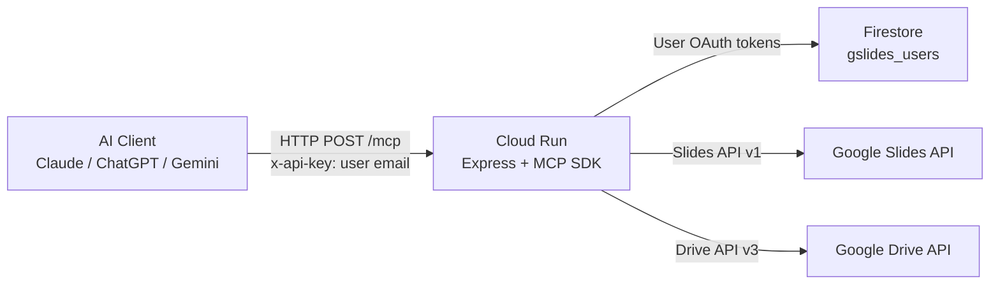

# Google Slides MCP Server

A [Model Context Protocol (MCP)](https://modelcontextprotocol.io/) server that wraps the Google Slides API, deployed on Google Cloud Run with per-user OAuth authentication.

## What is MCP?

The Model Context Protocol is an open standard that lets AI assistants (Claude, ChatGPT, Gemini, etc.) call external tools over a simple HTTP interface. This server exposes Google Slides operations as MCP tools, allowing any compatible AI client to create, read, and edit presentations on a user's behalf.

## Features

- **Per-user OAuth** -- each user authenticates with their own Google account; presentations go to their own Drive
- **Email verification** -- the OAuth callback verifies the Google account email matches the claimed identity
- **Five MCP tools** for full Slides control (see below)
- **Stateless HTTP transport** -- uses the MCP SDK's Streamable HTTP transport, ideal for serverless
- **Admin endpoints** -- list and remove authorized users
- **Firestore token storage** -- refresh tokens stored securely in Google Cloud Firestore

## MCP Tools

| Tool | Description |
|------|-------------|
| `create_presentation` | Create a new Google Slides presentation in the user's Drive |
| `get_presentation` | Get details about an existing presentation (with optional field mask) |
| `batch_update_presentation` | Apply a batch of update requests (add slides, insert text, shapes, images, etc.) |
| `get_page` | Retrieve a single slide by its page object ID |
| `summarize_presentation` | Extract all text content from every slide for summarization |

## Tech Stack

- **Runtime:** Node.js 20
- **Framework:** Express
- **APIs:** Google Slides API v1, Google Drive API v3, Google OAuth 2.0
- **Database:** Google Cloud Firestore (token storage)
- **Deployment:** Docker, Google Cloud Run
- **MCP SDK:** `@modelcontextprotocol/sdk` with Streamable HTTP transport

## Architecture



**Per-user auth flow:**

1. User visits `/auth` and enters their email
2. Redirected to Google OAuth consent (with `login_hint` pre-selecting their account)
3. On callback, the server verifies the Google account email matches the claimed email
4. Refresh token is stored in Firestore keyed by email
5. MCP client sends `x-api-key: user-email` on every request
6. Server looks up the token and calls the Slides API as that user

## Setup

### Prerequisites

- A GCP project with billing enabled
- Cloud Shell or `gcloud` CLI installed locally

### 1. Enable APIs

```bash
./setup.sh your-gcp-project-id asia-southeast1
```

This enables Slides, Drive, Firestore, Cloud Run, and Cloud Build APIs.

### 2. Create OAuth Client

```bash
./create-webclient.sh your-gcp-project-id
```

Follow the printed instructions to create an OAuth 2.0 Web Application client in the GCP Console. Copy the Client ID and Client Secret.

### 3. Deploy to Cloud Run

```bash
cp gslides-mcp/cloudshell-deploy.template.sh gslides-mcp/cloudshell-deploy.sh
# Edit cloudshell-deploy.sh with your PROJECT_ID, GOOGLE_CLIENT_ID, GOOGLE_CLIENT_SECRET
cd gslides-mcp
./cloudshell-deploy.sh
```

After the first deploy, copy the service URL and:
1. Add `<service-url>/auth/callback` as an Authorized Redirect URI on the OAuth client
2. Update `OAUTH_REDIRECT_URI` in `cloudshell-deploy.sh`
3. Re-deploy

### 4. Authorize a User

Visit in a browser:

```
https://your-service-url.a.run.app/auth
```

Enter your email and complete the Google OAuth flow.

## Environment Variables

| Variable | Required | Description |
|----------|----------|-------------|
| `GOOGLE_CLIENT_ID` | Yes | OAuth 2.0 client ID |
| `GOOGLE_CLIENT_SECRET` | Yes | OAuth 2.0 client secret |
| `OAUTH_REDIRECT_URI` | Yes | Full callback URL (`https://your-service-url.a.run.app/auth/callback`) |
| `FIRESTORE_COLLECTION` | No | Firestore collection name (default: `gslides_users`) |
| `PORT` | No | Server port (default: `8080`) |
| `ADMIN_KEY` | No | Key for `/admin/*` endpoints |

See `gslides-mcp/.env.example` for a template.

## Usage

### Connect from Claude / Claude Code

Add to your MCP client config:

```json
{
  "mcpServers": {
    "google-slides": {
      "type": "http",
      "url": "https://your-service-url.a.run.app/mcp",
      "headers": { "x-api-key": "your-email@example.com" }
    }
  }
}
```

### Health Check

```bash
curl https://your-service-url.a.run.app/healthz
```

### List Available Tools

```bash
curl -s -X POST https://your-service-url.a.run.app/mcp \
  -H "Content-Type: application/json" \
  -H "Accept: application/json, text/event-stream" \
  -H "x-api-key: your-email@example.com" \
  -d '{"jsonrpc":"2.0","id":1,"method":"tools/list"}'
```

## Project Structure

| File | Purpose |
|------|---------|
| `gslides-mcp/server.js` | Main MCP server (Express + MCP SDK) |
| `gslides-mcp/package.json` | Node.js dependencies |
| `gslides-mcp/Dockerfile` | Cloud Run container image |
| `gslides-mcp/.env.example` | Environment variable template |
| `gslides-mcp/cloudshell-deploy.template.sh` | Deploy script template |
| `setup.sh` | GCP API enablement script |
| `create-webclient.sh` | OAuth client creation helper |
| `configs/claude-code.json` | Example Claude Code MCP config |
| `SETUP.md` | Detailed step-by-step setup guide |

## License

MIT License. See [LICENSE](LICENSE) for details.
