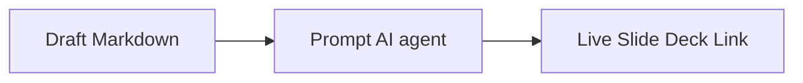

# Google Slides Model Context Protocol (MCP) Server

A Model Context Protocol (MCP) server that converts linear Markdown documents into styled Google Slides presentations.

The design is in favor of structured content containers, elegant color palettes, and color-matched vector icons.

---

## Themes & Design Aesthetics

The generator supports **5 custom themes** designed to fit different corporate, professional, and creative presentation requirements. You can dynamically switch styles for the exact same markdown file simply by passing a different `theme_name` argument:

| Theme Name | Style Personality | Header Font | Body Font | Palette | Ideal For |
| :--- | :--- | :--- | :--- | :--- | :--- |
| **`mckinsey`** | Consulting / Structured | Poppins | Lato | Cool Navy, Slate Blue, White Cards | Executive updates, strategy decks, corporate pitch slides |
| **`academic`** | Scholarly / Elegant | Georgia | Garamond | Rich Charcoal, Off-White, Thin Borders | Research papers, formal thesis overviews, lecture outlines |
| **`editorial`** | Print / Contemporary | Montserrat | Open Sans | Warm Terracotta, Warm Cream, Clean Minimal | Creative agency briefs, brand stories, product showcases |
| **`tech`** | High-Contrast / Modern | Orbitron | Inter | Geometric Slate, Deep Indigo, Neon Cyan Accent | Software architecture, developer docs, product roadmaps |
| **`zen`** | Storytelling / Minimalist | Outfit | Source Sans Pro | Charcoal Grey, Matte Black, Pure Bare-canvas | High-level keynotes, high-impact storytelling, simple decks |

---

## General Workflow

Creating Google Slides via this MCP server is a seamless three-step process:



1. **Draft your Slide Content:** Author a linear Markdown file containing slide titles, content paragraphs, and layout annotations using standard HTML comments (e.g., `<!-- layout: twin-cards -->`).
2. **Interact with the Assistant:** Prompt your AI session to generate slides, specifying your markdown filepath and your desired design aesthetic (e.g., `mckinsey` or `tech`).
3. **Open and Present:** The assistant processes your file, generates coordinate-based layouts, downloads high-res monochrome icons from the Icons8 CDN, recolors them to match your theme's palette, compiles them via Google Slides batch-update requests, and replies with your live edit URL!

---

## Setup and Configuration

### 1. Place Google Cloud Credentials
To write to your Google Drive, the server requires OAuth 2.0 client secrets from Google Cloud Console.

1. Go to the **[Google Cloud Console](https://console.cloud.google.com/)**.
2. Create or select a project and enable both the **Google Slides API** and **Google Drive API**.
3. Create an **OAuth consent screen** (External/Testing status), and add your Google email address as a **Test User**.
4. Create an **OAuth 2.0 Client ID** (Desktop Application) and download its client secrets JSON.
5. Save this downloaded JSON inside your home directory under the `.gemini` folder, named exactly **`credentials.json`**:
   * **Path:** `~/.gemini/credentials.json`

### 2. Run One-Time Authentication
MCP servers run headlessly in the background, which prevents interactive web authorization. You must run the initial token cache generation **once** manually in your terminal:

```bash
# Activate your python virtual environment
source .venv/bin/env/activate  # or use .venv/bin/python directly

# Launch the one-time authentication flow
.venv/bin/python server.py --auth
```

This will output an OAuth authorization link and attempt to open your default browser. Authorize the application with your test Google account. Once consent is completed, the authenticated token will be securely cached in:
* **Path:** `~/.gemini/google-slides-token.json`

*From this point forward, all slide generation runs completely headlessly without ever prompting you for authentication again!*

---

## Command Line Reference

You can test slide generation directly from your command line before exposing the server to your workspace.

### Run First-Time Local Compilation
```bash
.venv/bin/python -c "from server import convert_markdown_to_slides; print(convert_markdown_to_slides('test_slide.md', 'Premium Presentation', 'mckinsey'))"
```

### Start the MCP Server Manually
To start the FastMCP server in standard transport mode:
```bash
.venv/bin/python server.py
```

---

## AI/LLM Prompt Guide

Once integrated, you can direct the AI assistant using natural language. Here are standard, high-leverage prompts you can copy or adapt:

### 1. Generating a New Presentation
> **Prompt:**
> * "Generate a new Google Slides deck from my markdown file at `test_slide.md`. Name it 'Project Architecture Overview' and apply the **McKinsey** consulting theme."

### 2. Switching Themes for the Same Content
Because style is separated from structure, you can rapidly compile alternatives:
> **Prompt:**
> * "Can you take my `test_slide.md` content and re-compile it into a dark-mode **Tech** slide aesthetic? Title it 'Project Architecture - Tech version'."

### 3. Iterative Refinement
You can ask your agentic coding assistant to modify your source content first, then compile:
> **Prompt:**
> * "Open my `test_slide.md` file, add a new slide at the end about 'Testing and QA strategy' using a standard widescreen layout, and then run the slide converter tool to update the deck."

---

## Slide Annotation Spec

To ensure your presentation has rich visual diversity, structure your Markdown file with **layout comments**. If no layout comment is supplied, the engine defaults to a widescreen `standard` card layout.

### Title Slide Layout
Ideal for the opening slide. Generates large-font titles with high-contrast text and a left-bordered colored vertical block.
```markdown
# Building Next-Gen Agentic Codebases
<!-- layout: title -->
Exploring the structural division between Domain Experts and Code Generation Engines.
```

### Section Divider Layout
Creates high-impact, full-screen color-filled breakout slides to transition between topics.
```markdown
# Core Design Principles
<!-- layout: section -->
```

### Twin-Cards Layout
Perfect for comparison or separating contexts (e.g., Client vs. Server, Problem vs. Solution). Divides content into side-by-side white rounded cards with drop shadows.
```markdown
# Separating Domain and Engineering Contexts
<!-- layout: twin-cards -->

## Domain Expert Context
<!-- card: expert -->
- **Epistemic Anchoring**
  Grounds LLM reasoning in the exact ontology of the problem space to avoid drift.
- **Cognitive Guardrails**
  Explicit constraints on domain logic that prevent non-viable architecture.

## Engineering Context
<!-- card: developer -->
- **Technical Tradeoffs**
  Maps high-level design to technical capabilities and constraints.
- **Implementation Reality**
  Bridges conceptual domain models with actual API and database limits.
```

### Standard Layout
Organizes slide elements inside a breathable, centered widescreen container card featuring top-accent bands and customized icons.
```markdown
# Google Slides MCP Capabilities
<!-- layout: standard -->

## Main Slide Title
- **Beautiful Design**
  Applies cohesive styling, Poppins & Lato typography, and cool background color (#F1F5F9).
- **Interactive Authenticator**
  Uses User-level Google OAuth 2.0 with a local cache for secure and robust workspace integration.
```

---

## AI Agent Integration

To make this server available inside your standard AI agent application (such as Claude Desktop or any other standard MCP host), add this server block to your MCP configuration file:

```json
{
  "mcpServers": {
    "google-slides-mcp": {
      "command": "/path/to/google-slides-mcp/.venv/bin/python",
      "args": [
        "/path/to/google-slides-mcp/server.py"
      ],
      "env": {
        "PYTHONPATH": "/path/to/google-slides-mcp"
      }
    }
  }
}
```

Restart your AI agent application, and you will see the `convert_markdown_to_slides` tool available in your workspace or chat interface!
