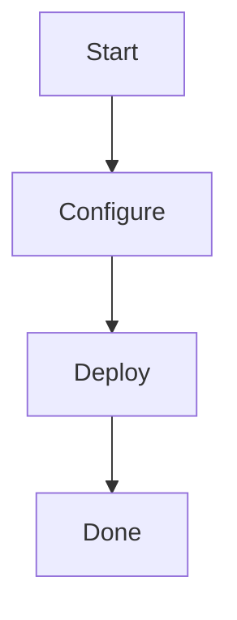

# pptx-generator

🎨 Generate professional PowerPoint presentations from Markdown files with automatic Mermaid diagram rendering.

## Features

- ✅ **Markdown to PowerPoint** - Convert structured Markdown into styled presentations
- ✅ **Mermaid Diagrams** - Automatic rendering of Mermaid flowcharts, Gantt charts, etc.
- ✅ **Adaptive Layouts** - Smart detection of portrait/landscape diagrams with configurable image layouts
- ✅ **Corporate Themes** - Customizable fonts, colors, and font sizes via JSON themes
- ✅ **Hierarchical Bullets** - Automatic bullet point hierarchy (multi-level support)
- ✅ **Comprehensive Logging** - DEBUG, INFO, WARNING, ERROR levels for troubleshooting
- ✅ **Debug Tools** - Built-in utilities to verify presentation content

## Documentation

- 📘 [Theme Configuration Guide](docs/THEME_CONFIG.md) - Complete theme customization reference
- 📗 [Logging Reference](docs/LOGGING.md) - Detailed logging and troubleshooting guide
- 📕 [Layout Rules](docs/LAYOUT_RULES.md) - Image layout and positioning guide
- 📙 [Mermaid Guide](docs/MERMAID_GUIDE.md) - Mermaid diagram usage and examples

## Installation

### From GitHub (Private Repo)

```bash
# Install directly from GitHub
pip install git+https://github.com/TahaSnoussi/pptx-generator.git

# Or clone and install locally
git clone https://github.com/TahaSnoussi/pptx-generator.git
cd pptx-generator
pip install -e .
```

### Prerequisites

- Python 3.8+
- [mermaid-cli](https://github.com/mermaid-js/mermaid-cli) (optional, for diagram rendering)

```bash
# Install mermaid-cli globally
npm install -g @mermaid-js/mermaid-cli
```

## Quick Start

### Command Line

```bash
# Generate a presentation
pptx-generate examples/Migration-Communication-3-Slides-With-Diagrams.md output/presentation.pptx

# With custom fonts
pptx-generate input.md output.pptx --font-title="Arial" --font-body="Calibri"

# With custom font sizes
pptx-generate input.md output.pptx --title-size=36 --body-size=16

# With theme JSON (includes fonts, colors, and sizes)
pptx-generate input.md output.pptx theme.json

# With verbose logging for debugging
pptx-generate input.md output.pptx --loglevel=DEBUG

# With INFO level logging
pptx-generate input.md output.pptx --loglevel=INFO

# Verify the generated presentation
pptx-utils summary output/presentation.pptx
pptx-utils slide4 output/presentation.pptx
```

### Python API

```python
from pptx_generator import generate_presentation

# Simple usage
generate_presentation("slides.md", "output.pptx")

# With custom options
generate_presentation(
    "slides.md", 
    "output.pptx",
    font_title="Segoe UI",
    font_body="Segoe UI Light",
    compact_bullets=True
)
```

## Markdown Format

### Slide Structure

Slides are separated by `---`:

```markdown
# Cover Slide Title
Subtitle text

---

## Slide Title

- Level 0 bullet
  - Level 1 bullet
    - Level 2 bullet

---
```

### Mermaid Diagrams

Include Mermaid diagrams directly in your Markdown:

````markdown
## Technical Architecture


````

### Literal Mode (Preserve Markdown Formatting)

To preserve Markdown formatting exactly as written **without any transformation**, add `<!-- literal -->` or `<!-- raw -->` at the beginning of the slide content:

````markdown
## My Slide with Literal Markdown

<!-- literal -->

# This is a heading

This is a paragraph with **bold** and *italic* text.

## Subheading

- Bullet 1
  - Sub-bullet 1.1
    - Sub-bullet 1.1.1
  - Sub-bullet 1.2

```
Code blocks are preserved
With proper indentation
    Even nested indentation
```

> Blockquotes are preserved
````

**With `<!-- literal -->`:**
- ✅ Indentation preserved
- ✅ Spaces and blank lines maintained
- ✅ Markdown characters (`#`, `-`, `*`, `>`) displayed as-is
- ✅ Code blocks preserved (except Mermaid which is still rendered)
- ✅ No bullet transformation to PowerPoint hierarchy

**Without the comment (Normal mode):**
- Bullets are transformed into PowerPoint hierarchy
- Code blocks are removed
- Markdown is processed as formatted text
- Blank lines are filtered

### Bullet Formatting

```markdown
- **Section Header**: Main topic
  - Sub-point 1
  - Sub-point 2
    - Detail level

- Numbered lists also supported:
  1. First step
  2. Second step
```

## Layout Detection

The generator automatically detects diagram orientation:

- **Portrait diagrams** (height > width): Text on left, diagram on right
- **Landscape diagrams** (width > height): Text on top (2 columns), diagram on bottom

## Utilities

Built-in debugging and verification tools:

```bash
# Check all content
pptx-utils content output.pptx

# Show shape positions
pptx-utils positions output.pptx

# Analyze slide 4 layout
pptx-utils slide4 output.pptx

# Complete summary
pptx-utils summary output.pptx

# Run all checks
pptx-utils all output.pptx
```

Available commands:
- `content` - Check paragraph content
- `positions` - Show shape positions/sizes
- `wrap` - Verify word wrap settings
- `slide4` - Detailed slide 4 analysis
- `summary` - Complete presentation summary
- `bullets` - Check bullet formatting
- `pics` - List all pictures
- `compare` - Compare content across slides
- `all` - Run all checks

## Project Structure

```
pptx-generator/
├── pptx_generator/
│   ├── __init__.py       # Package API
│   ├── generator.py      # Main presentation generator
│   ├── utils.py          # Debugging utilities
│   └── cli.py            # Command-line interface
├── examples/
│   └── Migration-Communication-3-Slides-With-Diagrams.md
├── docs/
│   ├── LAYOUT_RULES.md   # Layout documentation
│   └── MERMAID_GUIDE.md  # Mermaid usage guide
├── pyproject.toml
├── requirements.txt
└── README.md
```

## Configuration Options

### Command-line Options

```bash
pptx-generate input.md output.pptx [options]

Options:
  --font-title=FONT       Title font (default: Segoe UI)
  --font-body=FONT        Body font (default: Segoe UI Light)
  --title-size=N          Title font size in pt (default: 32)
  --body-size=N           Body font size in pt (default: 14)
  --border-thickness=N    Border thickness in pt (default: 4)
  --loglevel=LEVEL        Logging level: DEBUG, INFO, WARNING, ERROR (default: WARNING)
  --no-outline            Disable title outline
  --compact-bullets       Reduce bullet spacing
```

### Logging Levels

Control the verbosity of output with `--loglevel`:

- **ERROR** - Only show critical errors
- **WARNING** (default) - Show warnings and errors
- **INFO** - Show important operations (file loading, rendering, layouts)
- **DEBUG** - Show all details (every transformation, decision, image resize)

### Python API Options

```python
generate_presentation(
    input_md="slides.md",
    output_pptx="output.pptx",
    theme_json="theme.json",      # Optional theme file
    font_title="Arial",            # Override title font
    font_body="Calibri",           # Override body font
    border_thickness=Pt(4),        # Border thickness
    enable_outline=True,           # Title outlines
    compact_bullets=False          # Compact spacing
)
```

## Styling

### Default Theme

- **Background**: Black (#000000)
- **Title**: White (#FFFFFF), Segoe UI 44pt
- **Body**: Light Gray (#E6E6E6), Segoe UI Light 20/16/14/12pt (levels 0-2)
- **Slide Size**: 16:9 widescreen (10" × 5.625")

### Custom Theme

Create a `theme.json` file:

```json
{
  "theme_fonts": {
    "major": { "latin": "Arial" },
    "minor": { "latin": "Calibri" }
  },
  "theme_colors": {
    "dk2": "000000",
    "lt1": "FFFFFF",
    "accent2": "E6E6E6"
  },
  "theme_sizes": {
    "title": 32,
    "body": 14
  }
}
```

**Theme Properties:**
- `theme_fonts.major.latin` - Title font family
- `theme_fonts.minor.latin` - Body font family
- `theme_colors.dk2` - Background color (hex without #)
- `theme_colors.lt1` - Title color (hex without #)
- `theme_colors.accent2` - Body color (hex without #)
- `theme_sizes.title` - Title font size in points
- `theme_sizes.body` - Body font size in points

**Note:** Command-line options (`--font-title`, `--title-size`, etc.) override theme.json values.

## Use Cases

- 📊 **Technical Presentations** - Architecture diagrams, migration plans
- 📈 **Project Updates** - Status reports with Gantt charts
- 🎓 **Training Materials** - Step-by-step guides with flowcharts
- 📋 **Documentation** - Process documentation with visual aids

## Examples

See `examples/` directory for sample Markdown files:

- `Migration-Communication-3-Slides-With-Diagrams.md` - Complete example with Mermaid diagrams
- `Migration-Communication-3-Slides.md` - Text-only presentation
- `Example-With-Mermaid.md` - Mermaid diagrams demonstration

## Troubleshooting

### Mermaid diagrams not rendering

```bash
# Check if mmdc is installed
mmdc --version

# Install mermaid-cli
npm install -g @mermaid-js/mermaid-cli
```

### Bullets not visible

- **Placeholders** (slides 2, 3, 5): Use native PowerPoint bullets
- **Textboxes** (slide 4): Use manual `•` symbols

The generator handles this automatically.

### Text overflow

Use `--compact-bullets` flag to reduce spacing:

```bash
pptx-generate input.md output.pptx --compact-bullets
```

## Development

### Setup Development Environment

```bash
# Clone the repository
git clone https://github.com/TahaSnoussi/pptx-generator.git
cd pptx-generator

# Create virtual environment
python -m venv .venv
.venv\Scripts\activate  # Windows
source .venv/bin/activate  # Linux/Mac

# Install in editable mode with dev dependencies
pip install -e ".[dev]"
```

### Run Tests

```bash
# Generate test presentation
python -m pptx_generator.generator examples/Migration-Communication-3-Slides-With-Diagrams.md output/test.pptx

# Verify output
python -m pptx_generator.utils summary output/test.pptx
```

## License

MIT License - See LICENSE file for details

## Author

**Taha Snoussi**  
GitHub: [@TahaSnoussi](https://github.com/TahaSnoussi)

## Contributing

This is a personal project. For suggestions or issues, please open a GitHub issue.

---

**Made with ❤️ for automated presentation generation**
