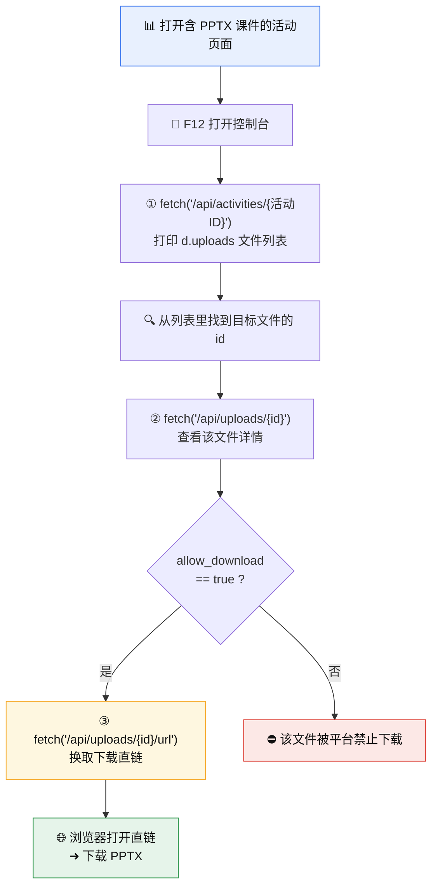
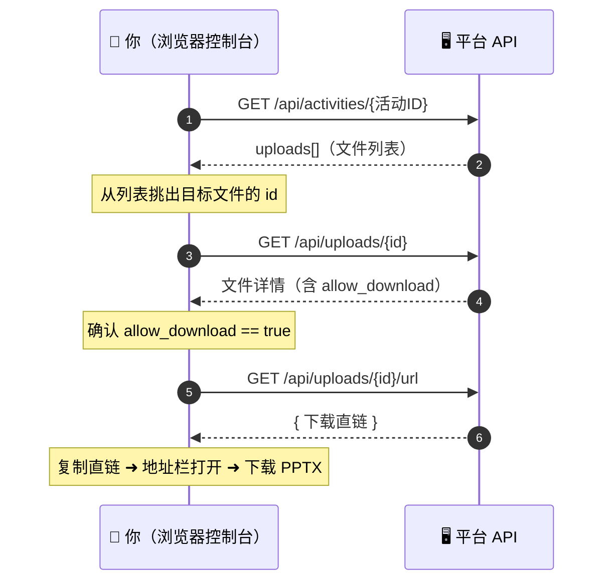

<div align="center">

# 📊 安医 PPTX 课件直链下载法

[English](README.en.md) | 中文

**安徽医科大学网络教学平台 · PPT/PPTX 课件「直链」提取与下载**


[](#)
[](#)
[](#)
[](#)
[](LICENSE)

*平台只让在线看、不给下载？用浏览器控制台调三个平台自带接口，就能拿到 PPTX 的真实下载地址。*

</div>

---

## 📖 目录

- [这是什么](#-这是什么)
- [适用场景](#-适用场景)
- [前置条件](#-前置条件)
- [原理速览](#-原理速览)
- [操作步骤](#-操作步骤)
- [接口时序](#-接口时序)
- [实战示例](#-实战示例)
- [常见问题 FAQ](#-常见问题-faq)
- [免责声明](#-免责声明)

---

## 🎯 这是什么

平台上的 PPT / PPTX 课件常常**只能在线预览、没有下载入口**。
但这些课件其实是通过平台自己的 **REST 接口**加载的——只要用你**已登录的身份**在控制台里调这几个接口，就能顺着「活动 → 文件 → 直链」一路拿到真实下载地址。

本方法做的事很简单：

> **借用平台自带的三个接口，从「活动 ID」查到「文件 ID」，再换取下载直链，最后用浏览器打开下载。**

## ✅ 适用场景

| 场景 | 是否适用 |
| :--- | :---: |
| 课件页面能正常预览 PPT/PPTX，但没有下载按钮 | ✅ |
| 想把课件保存到本地离线复习 | ✅ |
| 接口返回 `allow_download: false`（被明确禁止下载） | ❌ |
| 未登录 / 无该活动访问权限 | ❌ |

## 🧩 前置条件

1. 用浏览器**登录平台**，并打开包含目标 PPTX 课件的**活动 / 课程页面**。
2. 按 <kbd>F12</kbd>（Mac：<kbd>Cmd</kbd> + <kbd>Option</kbd> + <kbd>I</kbd>）打开**开发者工具**，切到 **Console（控制台）**。
3. 所有 `fetch` 都必须在**该平台的页面里**运行（相对路径 `/api/...` 依赖当前域名和你的登录 Cookie）。

---

## 🗺️ 原理速览



---

## 🛠️ 操作步骤

> 下面的命令可直接复制到控制台回车运行，也可从 [`snippets/`](snippets) 目录取用。
> 命令里的 `29489`、`621736` 都是**示例 ID**，请替换成你自己页面里的实际值。

### 第一步：列出活动下的所有课件（uploads）

在**活动页面**的控制台运行（把 `29489` 换成你的活动 ID）：

```javascript
fetch('/api/activities/29489').then(r=>r.json()).then(d=>console.log(d.uploads))
```

控制台会打印出该活动下所有上传文件的列表。**从列表里找到你要下载的那个 PPTX，记下它的 `id`**（本例中为 `621736`）。

> 💡 活动 ID 通常能从当前页面地址栏 / 页面数据里拿到；`d.uploads` 里每一项一般含 `id`、`name`（文件名）、`content_type` 等字段，按名字对号入座即可。

### 第二步：找到 id，查看该文件的详情

用上一步记下的 `id`（此处为 `621736`）运行：

```javascript
fetch('/api/uploads/621736').then(r => r.json()).then(d => console.log('upload:', JSON.stringify(d, null, 2)))
```

这会打印出该文件的完整信息。**重点看 `"allow_download"` 是否为 `true`**：

- ✅ `true` → 允许下载，继续第三步；
- ❌ `false` → 平台明确禁止下载该文件，本方法到此为止。

### 第三步：换取下载直链

确认 `allow_download` 为 `true` 后运行：

```javascript
fetch('/api/uploads/621736/url').then(r => r.json()).then(d => console.log(JSON.stringify(d, null, 2))).catch(e => console.log('err:', e))
```

### 第四步：获得下载链接

第三步返回的 JSON 里就是**下载直链**。复制该链接，**粘贴到浏览器地址栏回车**，即可下载 PPTX。🎉

---

## ⏱️ 接口时序



---

## 🔬 实战示例

```text
① fetch('/api/activities/29489')...  →  d.uploads 打印出：
   [ { id: 621736, name: "第2章 细胞.pptx", ... }, { id: 621740, ... } ]
   ➜ 目标是「第2章 细胞.pptx」，记下 id = 621736

② fetch('/api/uploads/621736')...  →  打印详情：
   { "id": 621736, "name": "第2章 细胞.pptx", "allow_download": true, ... }
   ➜ allow_download 为 true，可以下载

③ fetch('/api/uploads/621736/url')...  →  打印：
   { "url": "https://.../download/....pptx?token=...&expires=..." }
   ➜ 复制这个 url

④ 粘贴到地址栏回车 ➜ 浏览器开始下载「第2章 细胞.pptx」
```

> 示例中的活动 ID、文件 ID、返回字段与链接均为**示意值**，实际以你控制台跑出来的为准；直链通常带 `token` / `expires`，有时效，过期需重新走一遍流程。

---

## ❓ 常见问题 FAQ

<details>
<summary><b>Q1：<code>fetch</code> 报 401 / 403 或返回登录页？</b></summary>

说明没带上登录态。请确认：在<b>已登录</b>且<b>能正常打开该活动</b>的平台页面里运行；不要在新标签空白页运行（相对路径 <code>/api/...</code> 依赖当前域名与 Cookie）。
</details>

<details>
<summary><b>Q2：<code>d.uploads</code> 是空的 / 找不到文件？</b></summary>

活动 ID 可能不对，或该活动的课件不在 <code>uploads</code> 字段里。先确认活动 ID 正确（地址栏 / 页面数据里核对），再看返回 JSON 的其它字段。
</details>

<details>
<summary><b>Q3：<code>allow_download</code> 是 <code>false</code> 怎么办？</b></summary>

这是平台<b>明确禁止下载</b>的文件，请尊重设置，不要绕过。本方法仅适用于 <code>allow_download: true</code> 的文件。
</details>

<details>
<summary><b>Q4：第三步拿到 url 后打不开 / 提示过期？</b></summary>

直链带 <code>token</code> / <code>expires</code>，有<b>时效</b>。请重新运行第三步获取新的 url，尽快打开下载。若返回 <code>err</code>，检查是否登录态失效或 id 写错。
</details>

<details>
<summary><b>Q5：<code>29489</code> 和 <code>621736</code> 是什么？要改吗？</b></summary>

要改。<code>29489</code> 是<b>活动 ID</b>、<code>621736</code> 是<b>文件（upload）ID</b>，都只是原文档里的示例。请替换成你自己页面里查到的实际 ID。
</details>

---

## ⚖️ 免责声明

- 本项目仅为**个人学习与技术研究**用途，用于保存自己有权访问、且平台**允许下载**（`allow_download: true`）的课件以便离线复习。
- 请遵守所在学校 / 平台的**服务条款**与相关**著作权、版权**规定，**勿**用于批量爬取、二次分发或任何商业用途；对 `allow_download: false` 的文件请勿绕过。
- 因使用本方法产生的任何后果由使用者自行承担，作者与本项目**不承担责任**。
- 若平台方认为不妥，可联系作者删除。

---

<div align="center">

**觉得有用可以给个 ⭐ Star ～**

[MIT Licensed](LICENSE) · Made with ❤️ for AHMU students

</div>
